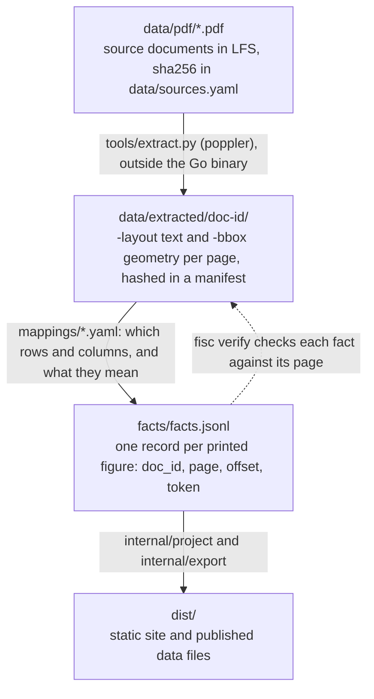

# fisc — the Livermore budget, with its sources attached

`fisc` turns the City of Livermore's published budget and financial reports
into a fact store, and the fact store into a static site for exploring the
budget: where the money comes from, what it buys, which department spends it,
and how that has changed.

Every figure the site shows is one the city printed, cited to the page and
cell it was read from, or is computed from such figures and cites all of
theirs. `fisc verify` fails if any link in that chain breaks.

## Sources

- [FY 2025-2027 Budget Book](https://www.livermoreca.gov/home/showpublisheddocument/12813), mapped in part
- [2025-2030 Capital Improvement Plan](https://www.livermoreca.gov/home/showpublisheddocument/12793), extracted, not yet mapped
- [FY 2024-25 Annual Comprehensive Financial Report](https://www.livermoreca.gov/home/showpublisheddocument/13545), mapped in part

URLs, retrieval dates and hashes are in [`data/sources.yaml`](data/sources.yaml).
Which pages each published file reads, and how it reconciles with them, is in
[`docs/`](docs/README.md).

This is an independent project and is not affiliated with or endorsed by the
City of Livermore.

## Build and look at it

Requires Go. Neither the PDFs nor Python are needed to build or verify.

```bash
make build                          # build bin/fisc
make test                           # tests, always with -race
make site                           # build the static site into dist/
python3 -m http.server -d dist 8000 # then open http://localhost:8000

./bin/fisc verify                   # every claim the fact store rests on
./bin/fisc verify --full            # also re-hashes the PDFs (needs git lfs pull)
```

To re-extract from the PDFs you also need `git lfs pull` and poppler
(`apt-get install -y poppler-utils` or `brew install poppler`), then
`make extract`. `fisc verify` pins the `pdftotext` version
(`corpus.PinnedPopplerVersion`); move the pin in the same commit as a
re-extraction, after reviewing the artifact diff.

### Retrieving them

`www.livermoreca.gov` is behind Akamai bot protection and returns **HTTP 403 to
a bare `curl`**. A full browser header set gets through:

```bash
curl -sSL --compressed \
  -A "Mozilla/5.0 (Macintosh; Intel Mac OS X 10_15_7) AppleWebKit/537.36 (KHTML, like Gecko) Chrome/126.0.0.0 Safari/537.36" \
  -H "Accept: text/html,application/xhtml+xml,application/xml;q=0.9,image/avif,image/webp,*/*;q=0.8" \
  -H "Accept-Language: en-US,en;q=0.9" \
  -H "Sec-Fetch-Dest: document" -H "Sec-Fetch-Mode: navigate" \
  -H "Sec-Fetch-Site: none" -H "Sec-Fetch-User: ?1" \
  -H "Upgrade-Insecure-Requests: 1" \
  "https://www.livermoreca.gov/home/showpublisheddocument/12813" -o budget.pdf
```

## How it fits together



## Working on it

Issues live in [beads](https://github.com/gastownhall/beads): `bd ready` for
available work. Rules for working on the tree are in [`AGENTS.md`](AGENTS.md).
The site deploys from CI on a green push to `main`.
