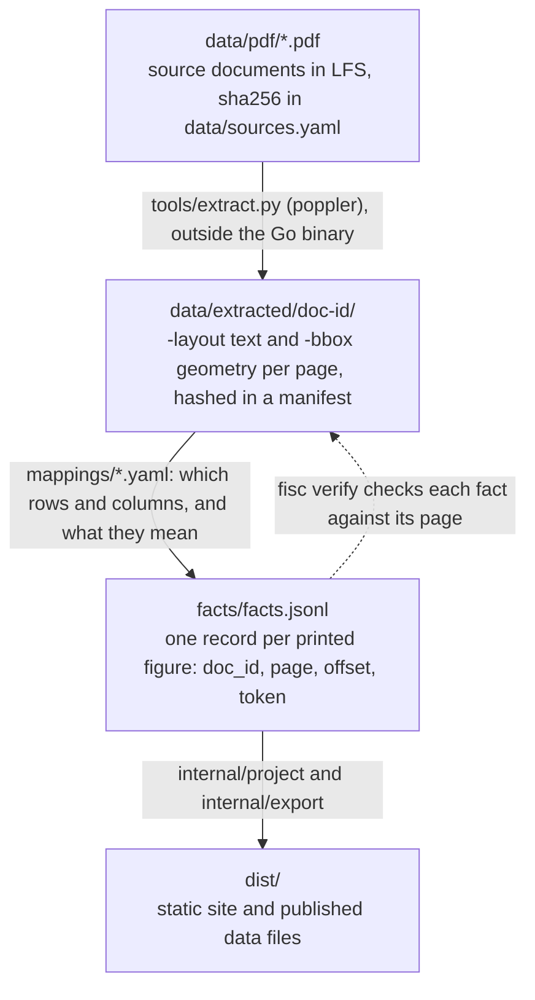

# fisc — the Livermore budget, with its sources attached

`fisc` turns the City of Livermore's published budget and financial reports
into a fact store, and the fact store into a static site for exploring the
budget: where the money comes from, what it buys, which department spends it,
and how that has changed.

Every figure the site shows cites the page and cell of the PDF it was read
from, and `fisc verify` fails if any link in that chain breaks.

## What is covered

| document | pages | extracted | mapped |
|---|---:|---:|---|
| FY 2025-2027 Budget Book | 268 | all | pp. 66–67, 76, 80–81, 85–125 in part, 127–140, 167–170, 172–183, 186–209, 222, 225–235 (odd pages) |
| 2025-2030 Capital Improvement Plan | 323 | all | none |
| FY 2024-25 Annual Comprehensive Financial Report | 195 | all | pp. 41, 121, 167–168, in part |

Each schedule reconciles against something the city itself printed:

| schedule | what it is | fiscal years |
|---|---|---|
| pp. 66–67 | the citywide spine, all funds gross | 2026, 2027 adopted |
| p. 76 | the transfer schedule, both legs of every transfer | 2026, 2027 adopted |
| pp. 80–81 | debt service by issue, and the debt service requirements scheduled to maturity | 2025 revised, 2026 + 2027 adopted; requirements projected from 2026 |
| pp. 85–125 | which funds pay for each department | 2024 actual, 2025 revised, 2026 + 2027 adopted |
| pp. 85–124 | departmentwide expenditure by object category | the same four |
| pp. 127–140 | revenue by fund and line item | the same four |
| pp. 167–170 | General Fund department × object category | the same four |
| p. 172 | the General Fund's expenditure by object category | the same four |
| pp. 173–183 | every other fund's expenditure by object category | the same four |
| pp. 186–209 | each fund's sources, uses and balances | 2024 actual, 2025 revised, 2026 + 2027 adopted |
| p. 222 | the Capital Improvement Plan's funding sources, transfers from operating funds among them | 2025 revised, 2026 + 2027 adopted |
| pp. 225–235 | every capital project, under the fund that pays for it | 2026 + 2027 adopted, 2028–2030 projected |
| ACFR p. 41 | the General Fund's revenues, transfers, General Government divisions and fund balances | 2025 audited |
| ACFR p. 121 | the General Fund's budget against its actuals: original, final and actual | 2025 |
| ACFR p. 167 | fund balances, ten years | 2016–2025, from the unaudited statistical section |
| ACFR p. 168 | changes in fund balances, ten years | 2016–2025, from the unaudited statistical section |

The spine gives the all-funds picture: $299,969,007 gross revenue and
$254,095,412 gross expenditure in FY2026, over six fund groups whose printed
`TOTAL SOURCES` and `TOTAL USES` the chart reconciles against exactly.

The site's pages are the views `data/views.yaml` declares, in nav order:

| nav label | page | what it shows |
|---|---|---|
| At a glance | `index.html` | where the money comes from, what it buys and which department spends it, as shares of the whole |
| Flows | `flows.html` | the fund groups as a Sankey with a year control; a node opens in place into the funds, divisions, lines or object rows printed beneath it |
| Bars | `ledger.html` | the same money as ranked bars |
| Over time | `change.html` | ten years of what the governmental funds took in and spent (ACFR p168), beside the budget's four revenue columns |
| Fund balances | `balances.html` | ten years of fund balances (ACFR p167) |
| Departments | `department.html` | every department as a bar of the funds that pay for it; open one for what it spends |
| Capital projects | `capital.html` | every capital project, under the fund that pays for it |
| Debt | `debt.html` | debt service by issue, and what is owed through maturity |
| Caveats | `caveats.html` | every limit on these figures, once, grouped by kind |
| Sources and data | `provenance.html` | every fact, its page, and the text it was read from |

Both ACFR schedules sit in the section the ACFR heads "(Unaudited)", and the
pages say so.

The CIP is extracted and unmapped. See `bd ready`.

## Build and look at it

Requires Go. Neither the PDFs nor Python are needed to build or verify.

```bash
make build                          # build bin/fisc
make test                           # tests, always with -race
make site                           # build the static site into dist/
python3 -m http.server -d dist 8000 # then open http://localhost:8000
```

The page fetches its column documents (`fy2026-adopted.json`, one per published
column) rather than inlining them, so it needs a server.

```bash
./bin/fisc build      # mappings/ + data/extracted/ -> facts/facts.jsonl
./bin/fisc verify     # every claim the fact store and the graph rest on
./bin/fisc verify --full   # also re-hashes the source PDFs (needs git lfs pull)
./bin/fisc export     # facts/facts.jsonl -> dist/
```

`fisc export` reads the committed facts and never re-runs the mapping engine, so
building the site cannot change a published figure.

To re-extract from the PDFs you also need `git lfs pull` and poppler, a system
package (`tools/extract.py` is standard library only):

```bash
apt-get install -y poppler-utils   # or: brew install poppler
make extract          # or: make extract DOC=livermore-budget-fy2026-2027
```

The committed artifacts were produced by `pdftotext` 24.02.0, and `fisc verify`
fails on a manifest recording another version (`corpus.PinnedPopplerVersion`).
A different poppler is expected to change extracted bytes: review the artifact
diff, and move the pin in the same commit as the re-extraction.

## How it fits together



The invariants the code enforces (integer cents, absent is not zero,
ambiguity fails closed, published is not derived) are in AGENTS.md,
"Provenance invariants". The rest of the documentation is indexed in
[`docs/README.md`](docs/README.md).

## Sources

Every URL and retrieval date is in [`data/sources.yaml`](data/sources.yaml);
`fisc verify --full` compares the committed PDFs against its hashes.

- [FY 2025-2027 Budget Book](https://www.livermoreca.gov/home/showpublisheddocument/12813)
- [2025-2030 Capital Improvement Plan](https://www.livermoreca.gov/home/showpublisheddocument/12793)
- [FY 2024-25 Annual Comprehensive Financial Report](https://www.livermoreca.gov/home/showpublisheddocument/13545)

### Retrieving them

`www.livermoreca.gov` is behind Akamai bot protection and returns **HTTP 403 to
a bare `curl`** (an `AkamaiGHost` error page, not a network failure). A full
browser header set gets through:

```bash
curl -sSL --compressed \
  -A "Mozilla/5.0 (Macintosh; Intel Mac OS X 10_15_7) AppleWebKit/537.36 (KHTML, like Gecko) Chrome/126.0.0.0 Safari/537.36" \
  -H "Accept: text/html,application/xhtml+xml,application/xml;q=0.9,image/avif,image/webp,*/*;q=0.8" \
  -H "Accept-Language: en-US,en;q=0.9" \
  -H "Sec-Fetch-Dest: document" -H "Sec-Fetch-Mode: navigate" \
  -H "Sec-Fetch-Site: none" -H "Sec-Fetch-User: ?1" \
  -H "Upgrade-Insecure-Requests: 1" \
  "https://www.livermoreca.gov/home/showpublisheddocument/12813" -o budget.pdf
```

Document permalinks take the form `/home/showpublisheddocument/<id>`. The
longer form with a trailing .NET-ticks value is a cache-buster; both serve the
same bytes, and `data/sources.yaml` records each. LFS uses sha256 as its
object ID, so the LFS OIDs are a second copy of the registry's hashes.

This is an independent project and is not affiliated with or endorsed by the
City of Livermore.

## Working on it

Issues live in [beads](https://github.com/gastownhall/beads): `bd ready` for
available work, `bd prime` for the workflow. Rules for working on the tree are
in [`AGENTS.md`](AGENTS.md); fixtures are catalogued in
[`testdata/README.md`](testdata/README.md).

The site publishes from the `pages-build` and `pages-deploy` jobs at the foot of
[`.github/workflows/ci.yml`](.github/workflows/ci.yml), on a push to `main` that
has gone green, once Pages is enabled (Settings → Pages → Source → *GitHub
Actions*). `dist/` is gitignored and built locally by `make site`.
