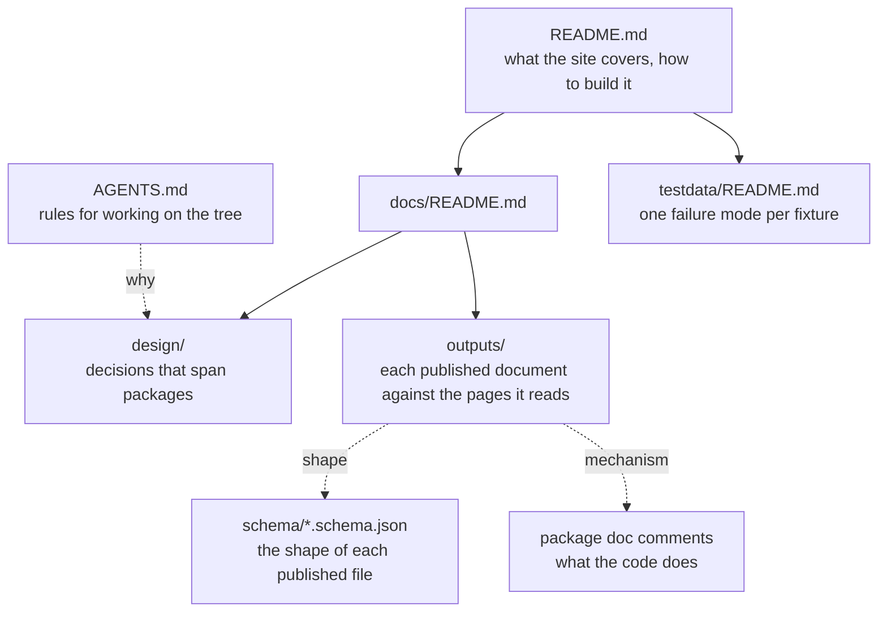

# Documentation

Each claim has one home. What a Go package does is in its doc comment
(`go doc ./internal/project`, and so on); a published shape is in `schema/`; a
rule an agent follows is in [`AGENTS.md`](../AGENTS.md). What is here is what
none of those can hold: measurements against the city's documents, and design
decisions that span packages.

## design/

- [`chart-model.md`](design/chart-model.md) — the layers from fact to pixel,
  what each may compute, and where Go stops and the client starts.
- [`extraction-substrate.md`](design/extraction-substrate.md) — what poppler's
  page text and word geometry do and do not carry, measured on the three PDFs.

## outputs/

One page per published document: which printed pages it reads, how its figures
reconcile with what the city printed, and what it does not claim.

- [`sankey.md`](outputs/sankey.md) — the citywide spine, Budget Book pp.66-67.
- [`fund-flows.md`](outputs/fund-flows.md) — the General Fund drill-down,
  pp.127-140, 167-170 and 173-183.
- [`revenue-trends.md`](outputs/revenue-trends.md) — revenue by fund and line,
  pp.127-140, four columns.
- [`acfr-history.md`](outputs/acfr-history.md) — the ACFR's ten-year
  fund-balance schedules, pp.167-168, and the p41 summary.
- [`fact-store.md`](outputs/fact-store.md) — the published record store under
  `facts/`.
