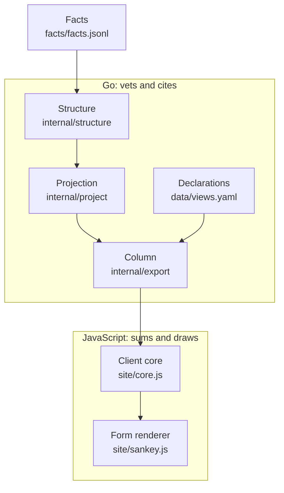

# The chart model: one model, drawn by forms

Evidence for the rule in AGENTS.md, "Go vets, JavaScript renders": what each
layer between a printed figure and a pixel may compute, and the measurements
that fixed the seams.

## Seven layers, each computing only what the one below cannot

| Layer | Where | May compute | Crosses the seam as |
|---|---|---|---|
| Facts | `facts/facts.jsonl` | nothing: one figure the city printed | `schema/fact.schema.json` |
| Structure | `internal/structure` | which cells exist; which differences between two schedules are licensed (a residue, a gap in cents) | Go only |
| Projection | `internal/project` | one graph per printed schedule: nodes `(id, label, tier, parent, role, derived)` and links `(value_cents, kind, fact_ids, locators, derived, partition, contra)`, every figure cited | `schema/projection.schema.json` |
| Column | `internal/export` | one node table per `(fiscal_year, basis)` and, per schedule, its parent edges and links indexed into that table; re-keys and orders, computes no new figure | `schema/column.schema.json` |
| Declarations | `internal/export`, authored in `data/views.yaml` and loaded by `pkg/cmd/export` | which schedule the page's chart draws (`primary`: the expansion schedule, whose `splits` say how each node opens in place), every sentence the page says, and per chart a **form** with that form's hints under its own key | `schema/page.schema.json`, as `window.FISC_CONFIG` |
| Client core | `site/core.js` | sums over cited figures: schedule assembly, hierarchy by parent chain, the frontier a list of splits comes to, the fold to that frontier, the cap, provenance union, years, wording, and the client marks with their figures: a capped split's tail and the smaller-flows mark, the reductions among a mark's ribbons, the pages cited around a node. Reads no form hint. | `schema/mark.schema.json` for the marks it makes |
| Form renderers | `site/sankey.js` | what depends on the screen and the mark type: which open splits a cap folds and into which tail, the slot each drawn node stands in, how tall the canvas grows, where a mark stands, layout, paint. Reads only its own hints. | nothing: a renderer emits pixels |

A figure the client shows is one Go cited, or a sum or union of such figures.
A count of drawn members or a share of one drawn sum in another is a sentence
about what is drawn, not a figure: the counts line, the search count, the
filter line's hidden and merged flows, a mark's hidden flows, the caveat
count, and the column share are of this kind, and each carries `◇`. A client
mark is derived, says so, and carries its rationale and source note like any
derived node.

## What a second form needs, and where it already is

Measured against `schema/column.schema.json` for a treemap of one schedule:

| Need | Where it is |
|---|---|
| The hierarchy under an opened node | `schedules[k].nodes[].parent`, walked by the core |
| A node's figure | the sum of the links at the node, or of its subtree's leaves; the core sums, under the licence every merged ribbon already has |
| Provenance of a cell | the union of `fact_ids` and `locators` over the links summed |
| Which cells open, and into what | the expansion schedule's `splits`: each node's `key`, `form` and `alternative`, read by the core (`splitsOf`, `expand`) |
| A remainder between a printed cell and its members | a derived node Go stitched, drawn like any other |
| Colour | `fund_groups[].slot` |
| Which tiers to tile; figure direction | absent by design: the form's own hint object |

So a second form adds one value to `chart_form` in `schema/enums.schema.json`,
one closed hint object under its own key in `schema/page.schema.json`, and one
renderer module, which `site/embed.go` embeds and the export ships as a
verbatim asset. The column document does not change.

## A form that is a page of its own, measured

`ledger.html` draws the expansion schedule as ranked bars. It is a
`chart_form` with a closed hint object under its own key (`sides_hints`: the
spine tiers drawn as sides, each with its heading) and a renderer module, as
the section above prices a second form. It is not registered in `app.js`'s `FORMS`, and `flows.html.tmpl` does not
draw it: measured at 6d46fd6, `site/app.js` reads a laid node's ribbons on
four paths (following the money, emphasis under a hover, the drawer's ribbon
list and a search reveal), and its chrome is ribbon vocabulary (the flow
table, the hairline line, the smaller-flows filter, "Follow the money"). A
form with no ribbons under that shell is a chart in another chart's clothes.
So the form's page module is `site/sides.js`, in the department page's
pattern, and it computes every figure through one core function,
`sideTree`: a root's figure is the sum of the folded ribbons joining it to
what is outside it, a member's the sum of those joining it to its parent hub,
each signed as the fold sums them. Measured over both pinned columns, the two
sides sum to one figure at every frontier and every one of the 20 root
splits ties to its members, two of them through printed reductions. The
middle tier is no side: a fund group both takes in and pays out, and
`validateSides` refuses it at the write.

## Why hints nest under the form's key

The expansion schedule's splits (`node`, `key`, `form`, `alternative`) are
read by the core and vetted by Go with the schedule. A form's hints (`tiers`,
`grow`, `split_caps` for the Sankey) are read by that renderer and by that
form's validation arm. Nesting them under `sankey` lets a closed schema refuse
a hint foreign to the declared form at the write, with no hand-written arm,
and gives the generated client typedefs one type per form.

## Why the client modules hold no state

`site/testlib.mjs` loads `app.js` through a cache-busting query so each test
gets a fresh module instance, because `app.js` reads `FISC_CONFIG` and `d3` at
import and keeps the list of splits and the fetched column as module state. A
module `app.js` imports by relative path carries no such query, so Node
instantiates it once per process and every test shares it. The core and each
renderer therefore keep no module-level `let` and read no global at import: a
global is read at call time or passed in. `site/modules.test.mjs` holds that
by importing each module with no `FISC_CONFIG` and no `d3` installed. The
core's one module-level store is a memo of assembled schedules keyed by the
column object, each entry a pure function of its key.

## Counts: which side is canonical

Go's `years[].counts` and `schedules[].counts` state what the document holds,
unfolded. The client's recount states what the drawn chart holds after the
filter, the cap and the fold, which only the client can know. Both are
published, each named for what it is.

## A lens

A lens restricts what is drawn to the nodes upstream or downstream of a
declared anchor. It never totals: the headline stays a named cut over an
antichain, so no figure the city never printed acquires a total. The walk
stops at a transfer edge, because transfers make the flow graph cyclic and a
closure that crossed one could swallow most of the city. The client walks, as
it folds; Go precomputes no closure. The declaration's syntax is `fisc-l8s5`.

## The renderer interface

A form module exports one object, `FormRenderer` in `site/app.js`, and `app.js`
reaches a form through it and in no other way: it imports no helper of a
form's and reads no hint. The page reads a laid mark's geometry itself, for
emphasis, focus and panning; what a laid mark's figure MEANS after the form
drew it (its signed cents, its share, how much of it is printed as
reductions) it asks the form, because only that layout knows. A renderer calls
the core for every figure and hands it only what the core cannot know, which
is where a mark stands. `app.js` refuses, with a banner and before any fetch,
a chart whose form it does not hold.
