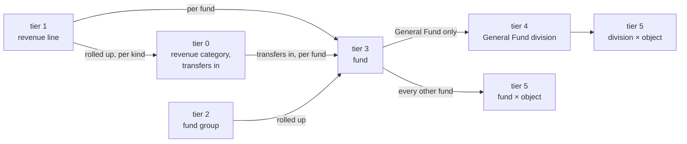

# The General Fund drill-down

The [citywide spine](sankey.md) prints six fund groups, ten revenue categories
and four object categories, and neither a fund nor a department axis. The
`fund-flows` documents read the schedules beneath it:

- pp.127-140, revenue by fund and line;
- pp.167-170, General Fund expenditure by division and object;
- pp.173-183, every other fund's expenditure by object.

Each is a schedule inside its column file, published only where both sides
print the column; one side alone would draw revenue against nothing.

| stem | column |
|---|---|
| `fund-flows-2024-actual` | FY2023-24 actual |
| `fund-flows-2025-revised` | FY2024-25 revised |
| `fund-flows` | FY2025-26 adopted |
| `fund-flows-2027` | FY2026-27 adopted |

The link-by-link shape, and why the middle links are emitted rather than left
to the client, is the `fundFlows` doc comment (`go doc -u ./internal/project
fundFlows`). In outline:

The grain is mixed because the pages are: pp.167-170 cover the General Fund
alone, so every other fund reaches its object categories with no division
between.

## Reading it

- **It has no headline.** Once one file holds the same money at two grains,
  "the total" is ambiguous; the spine is the only document that publishes the
  city's printed totals. The two are reconciled cell by cell, at zero
  tolerance, over the fact store.
- **Summing every link counts money more than twice.** Every expenditure fact
  is behind its object row and its division total; every revenue fact is behind
  its flow, its line's rollup and its fund's rollup. `counts.facts_cited_twice`
  is not zero.
- **An uncited fact is a printed dash.** Neither schedule prints a stock row.
- **A line reaches its category once per kind.** One printed row can reach the
  Internal Service Funds as an internal service charge and the rest of the city
  as external revenue: 2 of the 93 lines in both adopted columns.
- **A fund's rollup ties to its group.** Over both adopted columns each group's
  funds sum to within the declared residual of the cell pp.66-67 print for it,
  and to the cent for the three groups that carry none.
- **Reductions are negative links.** pp.127-140 print ERAF and RPTTF Reduction
  in parentheses inside the General Fund's Property Taxes; in FY2023-24 actual,
  `prior-year-unsecured` was negative too (`fisc-9psv`).
- **Three scopes share the document** because they are disjoint by kind or by
  page. `revenue-by-fund` and `transfers-by-fund` print $21,045,597 of FY2026
  transfers in at both ends, and that overlap is declared.
- **Every fund carries a `constraint_tier`**, which is our reading, disclosed
  as the spine's page describes ([`sankey.md`](sankey.md#constraint_tier)).
- **The revenue schedule is published twice**: here in one column, and on the
  Over time page in all four. A caveat says so.

## What it does not answer

- **Where the General Fund's money goes after the departments.** FY2025-26
  takes in $157,873,470 and spends $144,650,802 through eleven departments; the
  $13,222,668 difference is transfers out plus the change in working capital,
  printed on pp.66-67 and not carried here. There is no invented sink node, and
  a caveat says so.
- **What the other funds spend, by division.** pp.173-183 print them by object.
  pp.85-125's Department Funding Sources is a separate document,
  `department-funding`, which no split reaches yet (`fisc-yj4w.34.9`). A fund
  with spending on pp.173-183 and no revenue on pp.127-140 is drawn with nothing
  flowing in.
- **Transfers between funds.** p76's legs are `transfers-by-fund`.

## Why the client folds it

No page draws this document directly. `flows.html` draws the expansion schedule,
stitched from this document's links and the schedules beside it, and the
FY2024 and FY2025 documents have no spine column to open from.

**Unfolded, it draws blank.** Its fund column is 61 nodes. In 796px of usable
height at 14px node padding, d3-sankey shrinks the padding to
`min(14, 796/60) = 13.267` and leaves nothing for the values: every node height
and link width is 0px. At zero padding, 24 of the 61 funds are still under a
pixel and 45 under 8px, the General Fund being 49% of the column; the smallest
fund reaches one pixel on a canvas 64,203px tall.

So the client folds each node to its nearest drawn ancestor, merging links on
the folded pair and kind, summing cents and unioning fact ids and locators.
The locator union matters: on FY2025-26 at tiers `{0,2,4}`, 52 folded rows
carry 79 locators, at most 5 a row, where copying the first leg's would print
the document's 18 pages on every row. A capped split's tail is `derived: true`:
its value is a sum of printed figures, its grouping ours. Where Go stops and
the client starts is [`chart-model.md`](../design/chart-model.md).
