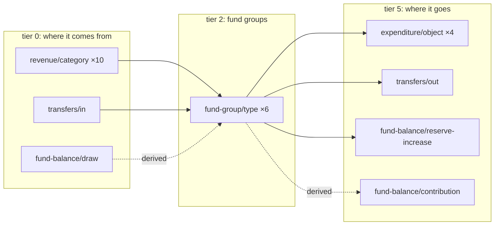

# The citywide spine

Budget Book pp.66-67 print the all-funds sources-and-uses summary: ten revenue
categories, transfers and fund balance in, four object categories, transfers
and reserves out, in six fund-group columns. The `sankey` projection draws it,
one document per adopted year, inside that year's column file
(`fy2026-adopted.json`, `fy2027-adopted.json`). Its shape is
`schema/projection.schema.json`; how it is built, where it is written and how
node ids map to tiers are in `go doc -all -u ./internal/project`. The worked example is
`testdata/sankey.golden.json`, real FY2026 figures with real fact ids.



Tiers 1, 3 and 4 are empty on the spine: pp.66-67 print each revenue category
as one row, and no fund or department axis. The page's chart opens these nodes
in place into the funds, divisions, lines and object rows the other schedules
print; that drill-down is [`fund-flows.md`](fund-flows.md).

## Reading it

- **Zero-valued links are omitted; their facts are not.** Most of the revenue
  grid is a dash: a category only the General Fund collects prints `-` in the
  other five columns.
- **A pair may carry one ribbon per kind.** A revenue row reaching the Internal
  Service Funds takes its money as an internal service charge and the rest of
  the city's as external revenue.
- **A link cites its facts twice.** `fact_ids` says which facts it summed;
  `locators` says which `(doc_id, page)` they were printed on. A fact id moves
  when the rule that read it is revised; a page does not, and the record store
  is laid out by page ([`fact-store.md`](fact-store.md)).
- **`partition: true`** marks a ribbon that divides one printed table along a
  second axis rather than following money: pp.85-125's division × object
  matrix. It is `false` on every other link.
- **`derived: true` means we inferred it.** On the spine only `CHANGE IN WORKING
  CAPITAL` is, printed once per column with a sign (`(1,034,154)` for the
  General Fund). A ribbon cannot be negative, so a negative change is drawn
  from `fund-balance/draw` and a positive one to `fund-balance/contribution`.
  `BEGINNING` and `ENDING WORKING CAPITAL` are stocks, not flows, and get no
  link; a caveat says so.
- **A node's words are the page's.** p66 prints ADDITION TO RESERVES where the
  taxonomy, after p75's header, says "Reserve Increase / (Use)"; the node
  carries p66's.
- **Counts.** In `testdata/sankey.golden.json`, the FY2026 spine alone, 120
  facts are in scope: 58 cited by a link and 62 not, the zero cells and the
  stock rows. The published column carries more schedules, so its counts are
  larger.

## Link kinds and the headline

The `all_funds_gross_*` figures tie to the printed schedule and include
internal service charges. The `external_*` figures count only `external`
links: an internal service charge is billed by one city department to another,
so counting it as revenue and as the payer's spending counts it twice.

| headline, FY2026 | dollars | |
|---|---:|---|
| `all_funds_gross_revenue_cents` | 299,969,007 | ties to the printed schedule; includes internal service charges |
| `all_funds_gross_expenditure_cents` | 254,095,412 | ties to the printed schedule |
| `external_revenue_cents` | 280,999,173 | gross less internal service |
| `external_expenditure_cents` | 229,018,045 | gross less internal service |
| `internal_transfer_in_cents` | 21,525,997 | |
| `internal_transfer_out_cents` | 59,612,734 | |
| `naive_expenditure_cents` | 313,708,146 | the wrong figure, published so the page can name it |
| `transfer_residual_cents` | 38,086,737 | out minus in; see below |

Summing the expenditure column gives $313,708,146 where the city spends
$254,095,412, 23% high, because transfers are counted at both ends.

## constraint_tier

`constraint_tier` is `""` on every spine node: a fund-group column holds funds
of several tiers. The fund groups do not partition by tier either:
`data/funds.yaml` puts both committed and restricted-by-law funds under
`capital` and `special-revenue`.

**Where a node carries one, the value is ours.** `data/funds.yaml` derives it
from the "Description of Funds" narrative, pp.258-261, which prints no such
classification. The fund node itself is printed, so `derived` stays `false`;
the disclosure travels on its `source_note` and `rationale` and as a caveat.
Every document that draws a fund node publishes its tier.

`""` and `unknown` are different claims: `""` means this document does not
classify the node; `unknown` means we read pp.258-261 and could not tell.

## The transfer residual

Transfers out ($59,612,734) exceed transfers in ($21,525,997) by $38,086,737.

p76's grand total is the transfers-in side to the cent: each destination
section equals the matching `TRANSFER IN:` cell on pp.66-67, and the General
Fund's out-flows equal `TRANSFER OUT:`.

**The difference is a column the city prints.** pp.72-75 are the same
sources-and-uses schedule with a `Transfers Out to CIP` heading, which pp.66-67
fold into `TRANSFER OUT:` and leave out of `TRANSFER IN:`:

```
p0073.txt:58   Transfers Out $21,525,997   Transfers Out to CIP $38,086,737
p0075.txt:58   Transfers Out $21,624,633   Transfers Out to CIP $50,762,251
```

$21,525,997 is p76's grand total and $38,086,737 is the residual, both to the
cent: the residual is transfers to capital projects, printed under their own
heading.

| transfers out to CIP, FY2026 | | source |
|---|---:|---|
| Capital Funds | 28,373,590 | `p0199.txt:13` |
| Enterprise Funds | 9,353,147 | `p0199.txt:14` |
| Special Revenue Funds | 320,000 | `p0199.txt:10` |
| Internal Service Funds | 40,000 | `p0073.txt:53`, `p0199.txt:17` |
| **total** | **38,086,737** | `p0073.txt:58`, `p0199.txt:21` |

pp.72-75 print to-CIP per major fund and one line for all non-major funds,
$28,693,590 in FY2026 (`p0073.txt:56`), so they cannot split Capital from
Special Revenue. pp.198-209 print it per fund and per fund type: FY2026's
summary is p199 above; FY2027's is p205 (Capital 35,830,251, `p0205.txt:13`;
Special Revenue 100,000, `p0205.txt:10`; together p75's non-major 35,930,251,
`p0075.txt:56`).

Each row equals the group's `TRANSFER OUT:` less the transfers p76 shows that
group paying, attributed by the payer in each row label. The General Fund's
$10,037,797 is itemised in full and contributes zero. Capital pays $211,150 of
its $28,584,740: Traffic Impact Fee (510), County Measure D (550) and State −
Gas Tax (560) are capital funds, and p76 lists all three as payers. So
`TRANSFER OUT == p76 paid + to CIP` holds for all six groups in both budget
years, and p222, which names each transferring fund, splits Capital from
Special Revenue as p199 and p205 do.

The residual is a headline figure, not a node. A synthetic link into
`transfers/in` would unbalance it, and splitting the $59.6M into matched and
unmatched parts would publish a division the city never printed.

## The contested total

p67's Internal Service Funds column prints Services & Supplies `16,796,010` for
FY2026-27, giving TOTAL EXPENDITURES `26,544,515`. Four other pages print
`26,294,515` (`p0183:64`, `p0075:53`, `p0205:17`, `p0209:20`, whose five
per-fund figures also sum to it), and `p0061:39` prints `26,906,515`, that
figure plus the `612,000` to-CIP transfer. Of the 48 fund group × object
category × budget year cells between pp.172-183 and pp.66-67, 47 agree to the
dollar and this is the 48th. That grid is our arithmetic: pp.172-183 print
per-fund object rows and one total per fund group, and no page prints a
group-by-object subtotal.

**We keep p67's figure.** The corrected Services & Supplies figure,
`16,546,010`, is printed on no page; it is the sum of five per-fund cells on
p183, and a fact is one figure the city printed. Correcting the fact is
refused by `fisc verify`, measured by mutation:

| mutation | the check that fails |
|---|---|
| `amount_cents` corrected, token left as printed | `fact-token-reparses`: token `"16,796,010"` is $16,796,010.00 but the fact carries $16,546,010.00 |
| `amount_cents` and token both corrected | `fact-offset-points-at-token`: p67 at offset 2548 is `"16,796,010"`, not `"16,546,010"` |

The FY2027 spine, in `fy2027-adopted.json`, carries the difference as a caveat; FY2026 ties everywhere.
Three declared exceptions carry the $250,000 on different axes, so each is an
independent witness: by fund group, by object category (pp.85-125 decompose the
money by department, division and object with no fund dimension, and still
put the difference in this category and year alone), and in the 48th cell
itself. A reissued p67 printing `26,294,515` would tie on its own, and
`fisc verify` would then refuse all three exceptions as claims the page no
longer supports (`fisc-av0w`).

## What the fund groups satisfy

For every fund group and fiscal year:

```
revenue + transfers_in + fund_balance_draw
    == expenditure + transfers_out + reserve_increase + fund_balance_contribution
```

FY2026, all six exact:

| fund group | in | out |
|---|---:|---:|
| general | 159,388,024 | 159,388,024 |
| enterprise | 80,761,261 | 80,761,261 |
| capital | 29,646,095 | 29,646,095 |
| debt-service | 6,984,597 | 6,984,597 |
| special-revenue | 29,279,560 | 29,279,560 |
| internal-service | 25,117,367 | 25,117,367 |

These are the city's own `TOTAL SOURCES` and `TOTAL USES` rows, so the
identity is a cross-check, not a restatement.

Which printed row is which category and kind is
`mappings/livermore-budget-fy2026-2027.yaml`'s, over `data/taxonomy.yaml`'s
slugs.
